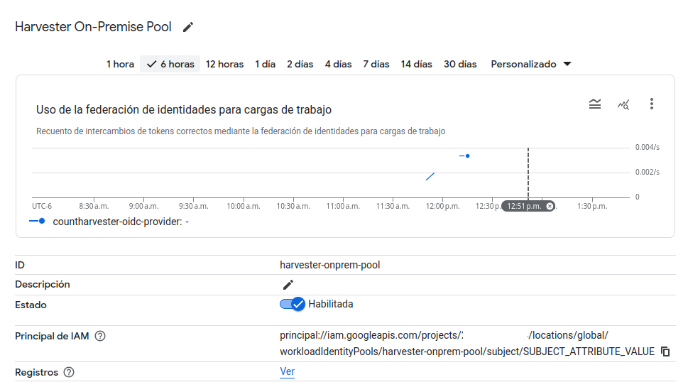
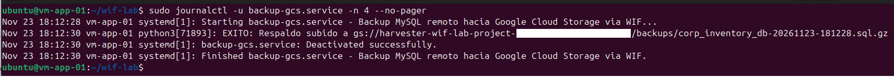

# Respaldo Automatizado Zero-Trust de Bases de Datos On-Premise hacia Google Cloud Storage (sin Llaves JSON Estáticas)


## 1.Problema de Ingeniería

Las organizaciones que operan infraestructura híbrida enfrentan un reto crítico al integrar cargas de trabajo locales con la nube pública: distribuir archivos de credenciales estáticas (llaves JSON de Service Accounts) en servidores on-premise introduce un riesgo elevado de exfiltración y compromete el cumplimiento de auditorías de seguridad. Adicionalmente, muchos entornos remotos operan detrás de enlaces **CGNAT** sin direcciones IP públicas fijas ni puertos entrantes abiertos.

Este proyecto resuelve ambos desafíos mediante una arquitectura híbrida **Zero-Trust** que extrae volcados comprimidos de una base de datos aislada en **Harvester HCI** y los deposita en **Google Cloud Storage** utilizando **Workload Identity Federation (OIDC/STS)** en modo `executable`, generando tokens efímeros bajo demanda y manteniendo un costo operativo de **$0.00 USD**.

---

## 2. Arquitectura Híbrida

```text
+-----------------------------------------------------------------------------------+
|                        INFRAESTRUCTURA ON-PREMISE (HARVESTER HCI)                 |
|                                                                                   |
|  +-----------------------------+          +------------------------------------+  |
|  |   vm-db-private (VLAN Priv) |          |     vm-app-01 (Bridge / Worker)    |  |
|  |         10.0.2.30           |          |             10.0.2.20              |  |
|  |                             |  MySQL   |                                    |  |
|  |  - MySQL 8.0                |<---------|  - systemd timer (02:00 UTC)       |  |
|  |  - Sin salida a Internet    |  Puerto  |  - mysqldump (--no-tablespaces)    |  |
|  |  - Usuario backup_user      |   3306   |  - get_wif_token.py (JWT 5 min)    |  |
|  |    restringido a 10.0.2.20  |          |  - private.pem (RSA-2048 local)    |  |
|  +-----------------------------+          +------------------+-----------------+  |
+--------------------------------------------------------------|--------------------+
                                                               |
                                     Tráfico HTTPS Saliente    | (1) Intercambio JWT -> STS
                                     (Compatible con CGNAT)    | (2) Impersonación IAM
                                                               v
+-----------------------------------------------------------------------------------+
|                          GOOGLE CLOUD PLATFORM (GCP)                              |
|                                                                                   |
|  +-----------------------------------+    +------------------------------------+  |
|  |   Security Token Service (STS)    |    |     IAM Credentials & Service      |  |
|  |   & Workload Identity Pool        |--->|     Account (sa-harvester-app)     |  |
|  |                                   |    |                                    |  |
|  |  - Valida firma vs jwks.json      |    |  - Emite OAuth2 Token (1 hr)       |  |
|  |  - Condición: hostname==vm-app-01 |    |  - Rol: roles/storage.objectAdmin  |  |
|  +-----------------------------------+    +------------------+-----------------+  |
|                                                              |                    |
|                                                              v (3) Upload TLS     |
|                                           +------------------------------------+  |
|                                           |      Cloud Storage Bucket          |  |
|                                           |      (Región: us-central1)         |  |
|                                           |                                    |  |
|                                           |  - Uniform Bucket-Level Access     |  |
|                                           |  - Soft Delete (7 días)            |  |
|                                           |  - Lifecycle Rule: Delete > 7 días |  |
|                                           +------------------------------------+  |
+-----------------------------------------------------------------------------------+
```

---

## 3. Controles de Seguridad y Decisiones de Diseño

| Capa / Dominio | Control Implementado | Impacto en Seguridad y FinOps |
| :--- | :--- | :--- |
| **Autenticación Cloud** | Workload Identity Federation (OIDC) con JWKS público cargado en GCP y modo `executable`. | Elimina llaves JSON estáticas; tokens OIDC caducan en 5 min y se renuevan al vuelo. |
| **Control de Admisión** | `Attribute Condition`: `assertion.hostname == 'vm-app-01'` y audiencia restringida. | Impide que otros nodos emitan tokens válidos incluso dentro del mismo Pool. |
| **Menor Privilegio IAM** | Rol `roles/storage.objectAdmin` vinculado únicamente a nivel de Bucket (no de proyecto). | Acota el radio de impacto (*blast radius*) exclusivamente al repositorio de respaldos. |
| **Aislamiento de Datos** | VM de BD sin salida a Internet; usuario MySQL restringido a IP `10.0.2.20` y `--no-tablespaces`. | Elimina exposición directa a Internet y evita otorgar privilegios globales `PROCESS`. |
| **Seguridad en Runtime** | Contraseña de BD inyectada vía variable de entorno `MYSQL_PWD` en `systemd`. | Evita la exposición de credenciales en argumentos de procesos (`ps aux`). |
| **Gobierno y FinOps** | Bucket Standard en `us-central1` (< 5 GB) + Lifecycle Rule (`Delete` cuando `age >= 7`). | Costo operativo de **$0.00 USD** (*Always Free Tier*) sin acumulación histórica. |

---

## 4. Estructura del Repositorio

```text
.
├── gcp/
│   ├── setup_gcp_wif.sh          # Aprovisionamiento de Bucket, SA, WIF Pool y OIDC Provider
│   └── lifecycle.json            # Política de ciclo de vida (purga automática a los 7 días)
├── on-premise/
│   ├── setup_idp.py              # Generador de par RSA-2048 y extracción de llave pública JWKS
│   ├── get_wif_token.py          # Emisor bajo demanda de JWT efímero (5 min) para modo executable
│   ├── credential-config.json    # Configuración externa ADC (sin secretos embebidos)
│   └── backup_db_to_gcs.py       # Extracción mysqldump, compresión gzip y carga a GCS
└── systemd/
    ├── backup-gcs.service        # Unidad de servicio con inyección segura de variables
    └── backup-gcs.timer          # Temporizador de ejecución diaria automatizada
```

---

## 5. Guía de Implementación Reproducible

### Paso 1: Aprovisionamiento en Google Cloud Platform (`gcp/setup_gcp_wif.sh`)

```bash
export PROJECT_ID="<TU_PROJECT_ID>"
export PROJECT_NUMBER="<TU_PROJECT_NUMBER>"
export REGION="us-central1"
export BUCKET_NAME="harvester-wif-lab-${PROJECT_ID}"
export SA_NAME="sa-harvester-app"
export POOL_ID="harvester-onprem-pool"
export PROVIDER_ID="harvester-oidc-provider"

gcloud config set project $PROJECT_ID

# 1. Habilitar APIs necesarias
gcloud services enable   iam.googleapis.com   cloudresourcemanager.googleapis.com   iamcredentials.googleapis.com   sts.googleapis.com   storage.googleapis.com

# 2. Crear Bucket regional (Always Free Tier) y Service Account con menor privilegio
gcloud storage buckets create gs://${BUCKET_NAME}   --location=${REGION}   --uniform-bucket-level-access

gcloud iam service-accounts create ${SA_NAME}   --display-name="Harvester App Workload SA"

gcloud storage buckets add-iam-policy-binding gs://${BUCKET_NAME}   --member="serviceAccount:${SA_NAME}@${PROJECT_ID}.iam.gserviceaccount.com"   --role="roles/storage.objectAdmin"

# 3. Crear Workload Identity Pool y OIDC Provider con JWKS público
gcloud iam workload-identity-pools create ${POOL_ID}   --location="global"   --display-name="Harvester On-Premise Pool"

gcloud iam workload-identity-pools providers create-oidc ${PROVIDER_ID}   --location="global"   --workload-identity-pool=${POOL_ID}   --display-name="Harvester Local OIDC Provider"   --issuer-uri="https://idp.harvester.local"   --allowed-audiences="https://iam.googleapis.com/projects/${PROJECT_NUMBER}/locations/global/workloadIdentityPools/${POOL_ID}/providers/${PROVIDER_ID}"   --attribute-mapping="google.subject=assertion.sub,attribute.host=assertion.hostname"   --attribute-condition="assertion.hostname == 'vm-app-01'"   --jwk-json-path="jwks.json"

# 4. Autorizar impersonación para el sujeto vm-app-01
gcloud iam service-accounts add-iam-policy-binding   "${SA_NAME}@${PROJECT_ID}.iam.gserviceaccount.com"   --role="roles/iam.workloadIdentityUser"   --member="principal://iam.googleapis.com/projects/${PROJECT_NUMBER}/locations/global/workloadIdentityPools/${POOL_ID}/subject/vm-app-01"
```

### Paso 2: Regla de Ciclo de Vida en Cloud Storage (`gcp/lifecycle.json`)

```json
{
  "lifecycle": {
    "rule": [
      {
        "action": { "type": "Delete" },
        "condition": {
          "age": 7,
          "matchesPrefix": ["backups/"]
        }
      }
    ]
  }
}
```

### Paso 3: Emisor de Token Efímero bajo Demanda (`on-premise/get_wif_token.py`)

```python
#!/opt/wif-lab/venv/bin/python3
import json
import time
import jwt

PROJECT_NUMBER = "<TU_PROJECT_NUMBER>"
POOL_ID = "harvester-onprem-pool"
PROVIDER_ID = "harvester-oidc-provider"

with open("/home/ubuntu/wif-lab/private.pem", "rb") as f:
    private_key = f.read()

now = int(time.time())
exp = now + 300  # Token efímero válido por 5 minutos

payload = {
    "iss": "https://idp.harvester.local",
    "sub": "vm-app-01",
    "hostname": "vm-app-01",
    "aud": f"https://iam.googleapis.com/projects/{PROJECT_NUMBER}/locations/global/workloadIdentityPools/{POOL_ID}/providers/{PROVIDER_ID}",
    "iat": now,
    "exp": exp
}

token = jwt.encode(payload, private_key, algorithm="RS256", headers={"kid": "harvester-key-1"})

print(json.dumps({
    "version": 1,
    "success": True,
    "token_type": "urn:ietf:params:oauth:token-type:jwt",
    "id_token": token,
    "expiration_time": exp
}))
```

### Paso 4: Configuración Externa de Credenciales (`on-premise/credential-config.json`)

```json
{
  "universe_domain": "googleapis.com",
  "type": "external_account",
  "audience": "//iam.googleapis.com/projects/<TU_PROJECT_NUMBER>/locations/global/workloadIdentityPools/harvester-onprem-pool/providers/harvester-oidc-provider",
  "subject_token_type": "urn:ietf:params:oauth:token-type:jwt",
  "token_url": "https://sts.googleapis.com/v1/token",
  "credential_source": {
    "executable": {
      "command": "/home/ubuntu/wif-lab/get_wif_token.py",
      "timeout_millis": 5000
    }
  },
  "service_account_impersonation_url": "https://iamcredentials.googleapis.com/v1/projects/-/serviceAccounts/sa-harvester-app@<TU_PROJECT_ID>.iam.gserviceaccount.com:generateAccessToken"
}
```

### Paso 5: Script de Respaldo y Orquestación `systemd`

**`on-premise/backup_db_to_gcs.py`**
```python
#!/home/ubuntu/wif-lab/venv/bin/python3
import os
import subprocess
from datetime import datetime, timezone
from google.cloud import storage

PROJECT_ID = "<TU_PROJECT_ID>"
BUCKET_NAME = "harvester-wif-lab-<TU_PROJECT_ID>"
DB_HOST = "10.0.2.30"
DB_USER = "backup_user"
DB_NAME = "corp_inventory_db"

timestamp = datetime.now(timezone.utc).strftime("%Y%m%d-%H%M%S")
local_gz = f"/tmp/{DB_NAME}-{timestamp}.sql.gz"
gcs_blob_path = f"backups/{DB_NAME}-{timestamp}.sql.gz"

dump_cmd = f"mysqldump -h {DB_HOST} -u {DB_USER} --single-transaction --no-tablespaces {DB_NAME} | gzip > {local_gz}"
subprocess.run(dump_cmd, shell=True, check=True)

client = storage.Client(project=PROJECT_ID)
bucket = client.bucket(BUCKET_NAME)
blob = bucket.blob(gcs_blob_path)
blob.upload_from_filename(local_gz)

os.remove(local_gz)
print(f"EXITO: Respaldo subido a gs://{BUCKET_NAME}/{gcs_blob_path}")
```

**`systemd/backup-gcs.service`**
```ini
[Unit]
Description=Backup MySQL remoto hacia Google Cloud Storage via WIF
After=network-online.target
Wants=network-online.target

[Service]
Type=oneshot
User=ubuntu
Environment="GOOGLE_APPLICATION_CREDENTIALS=/home/ubuntu/wif-lab/credential-config.json"
Environment="GOOGLE_EXTERNAL_ACCOUNT_ALLOW_EXECUTABLES=1"
Environment="MYSQL_PWD=<PASSWORD_SEGURO>"
ExecStart=/home/ubuntu/wif-lab/venv/bin/python3 /home/ubuntu/wif-lab/backup_db_to_gcs.py
```

**`systemd/backup-gcs.timer`**
```ini
[Unit]
Description=Ejecucion diaria de backup MySQL hacia GCS

[Timer]
OnCalendar=*-*-* 02:00:00
Persistent=true

[Install]
WantedBy=timers.target
```

---

## 6. Validación y Auditoría Operativa

* **Ejecución desatendida (`journalctl`):**
  ```text
  Starting backup-gcs.service - Backup MySQL remoto hacia Google Cloud Storage via WIF...
  EXITO: Respaldo subido a gs://harvester-wif-lab-<PROJECT_ID>/backups/corp_inventory_db-20261123-181228.sql.gz
  backup-gcs.service: Deactivated successfully.
  Finished backup-gcs.service - Backup MySQL remoto hacia Google Cloud Storage via WIF.




  ```
* **Trazabilidad en GCP:** Validación de creación de recursos y políticas IAM mediante **Cloud Audit Logs** (`Admin Activity`) y confirmación de purga automática mediante **Object Lifecycle Management** en Cloud Storage.

---

**Autor:** Ing. Jose Mario Bolaños — Cloud & Infrastructure Engineering
